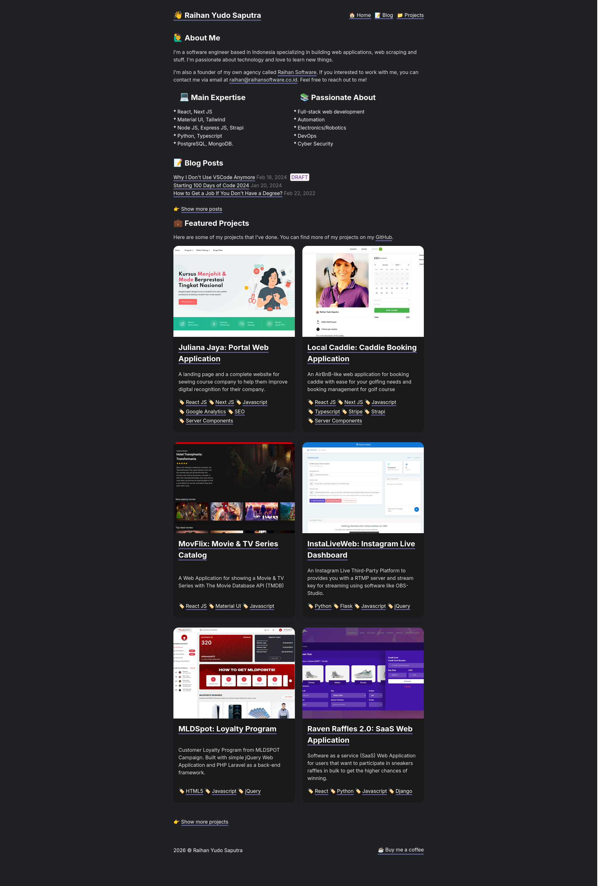

# Raihan Yudo Saputra - Personal Website

> A personal portfolio and blog built with [Hugo](https://gohugo.io/).



## 🚀 Features

- **About Me**: Brief intro, expertise, and interests.
- **Blog**: Technical articles and thoughts.
- **Projects**: Portfolio showcase with featured images and tags.
- **Fast & Minimal**: Custom clean theme with dark mode by default.

## 🛠️ Tech Stack

- **Static Site Generator**: [Hugo](https://gohugo.io/) (Extended)
- **Deployment**: GitHub Pages (via GitHub Actions)

## 💻 Local Development

### Prerequisites

- [Hugo Extended](https://gohugo.io/installation/) (v0.120+ recommended)

### Running Locally

1. Clone the repository:
   ```bash
   git clone https://github.com/RaihanStark/personalwebsite.git
   cd personalwebsite
   ```

2. Start the Hugo development server:
   ```bash
   hugo server -D
   ```

3. Open your browser and navigate to:
   ```
   http://localhost:1313/
   ```

### Building for Production

To build the static site files into the `public/` directory:

```bash
hugo --minify
```
